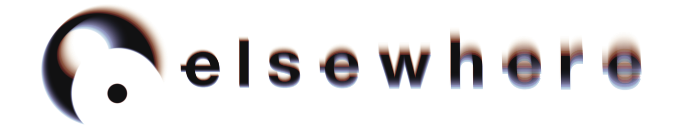
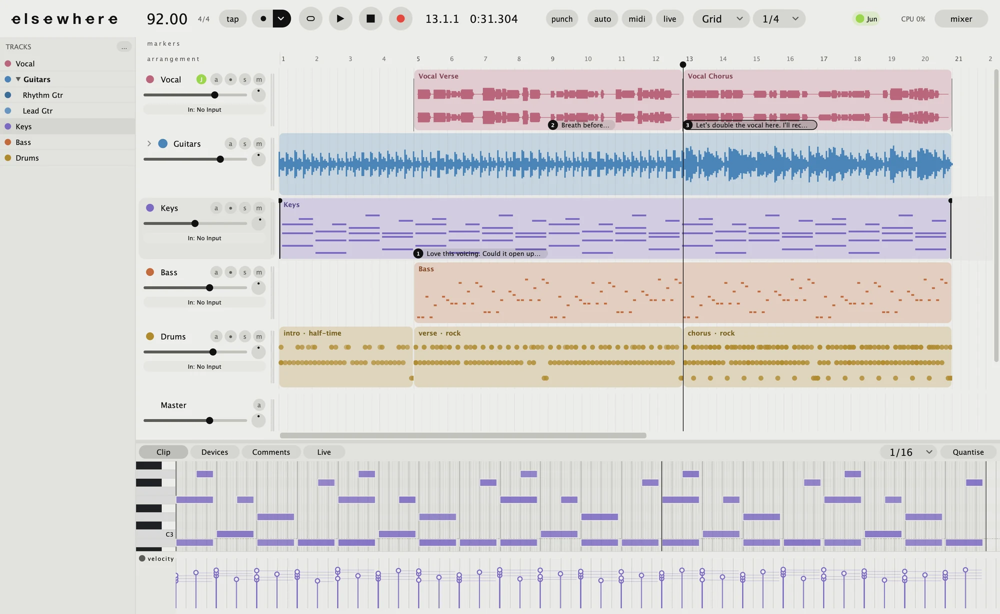
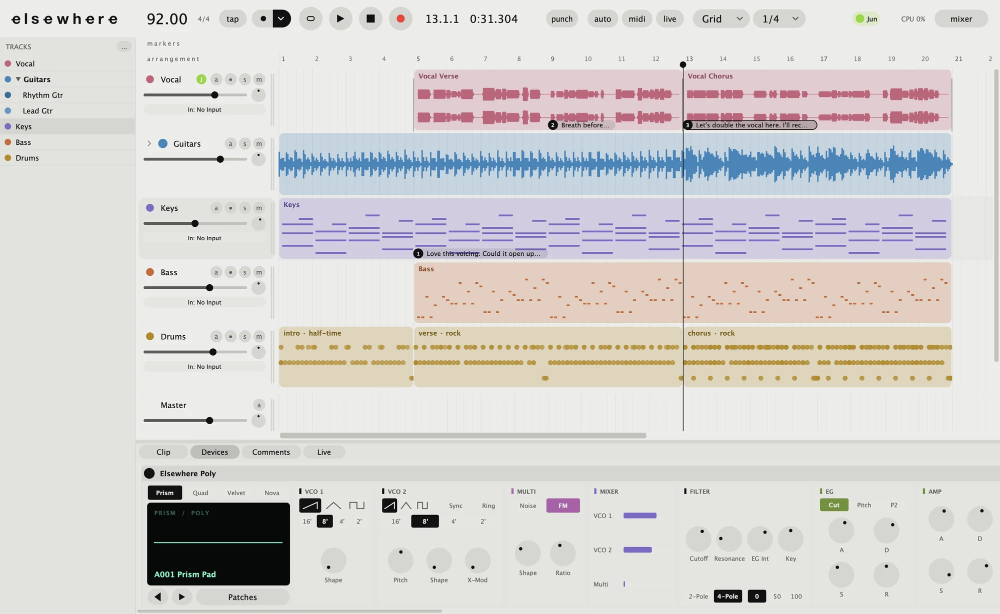
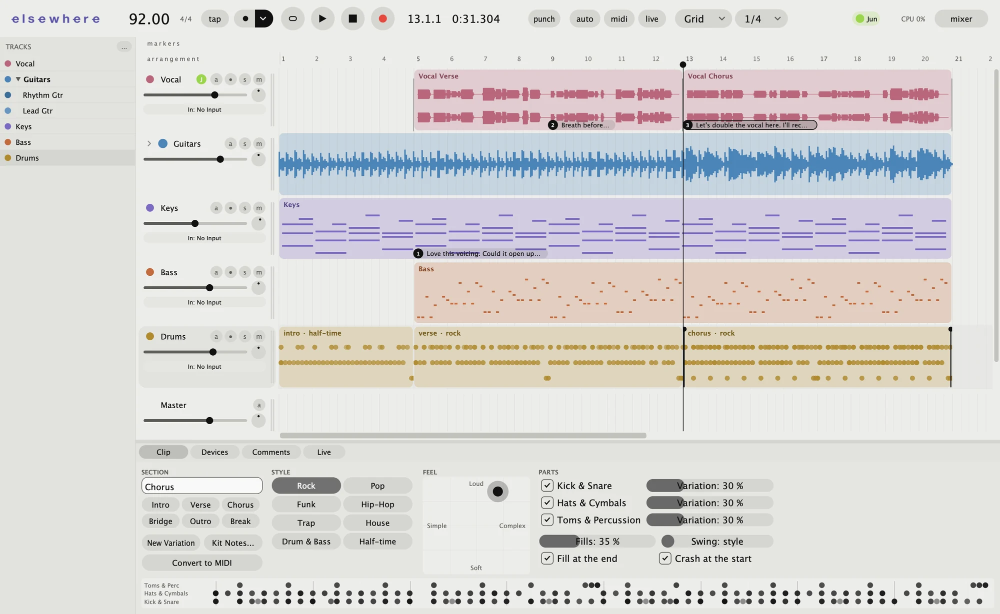
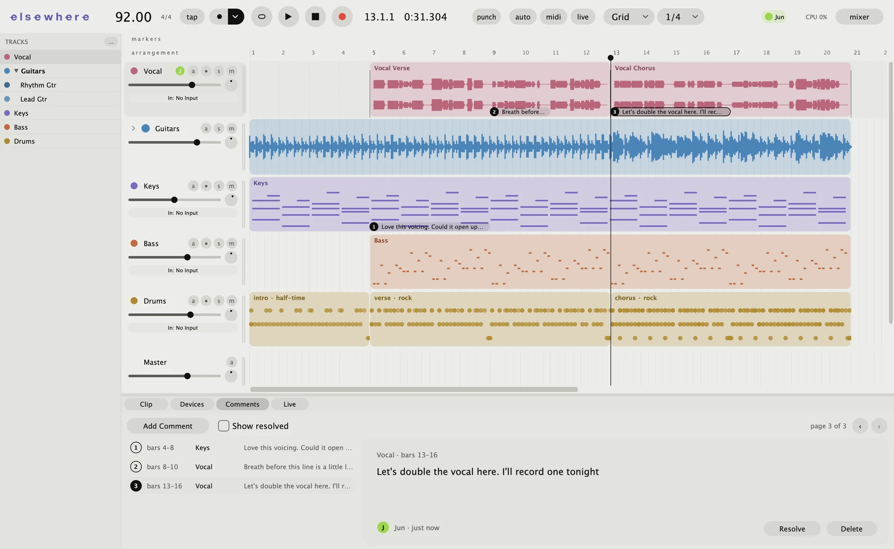
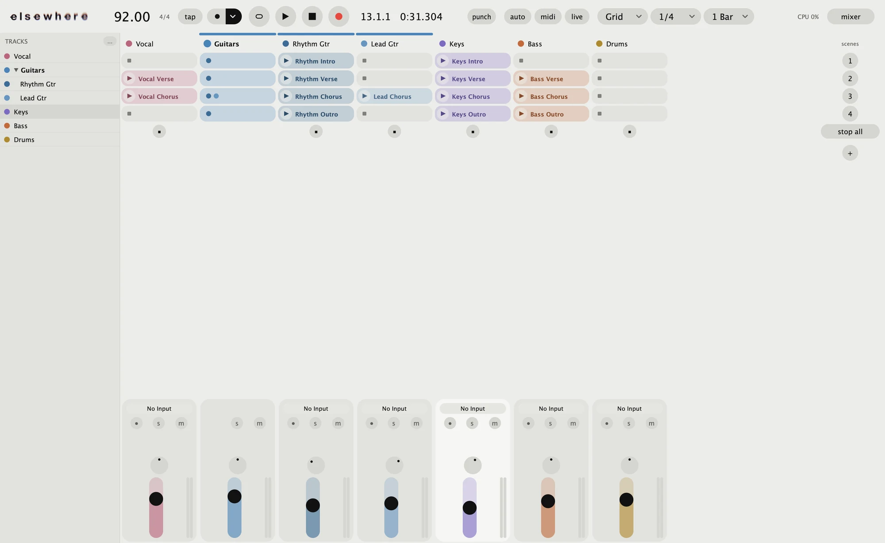
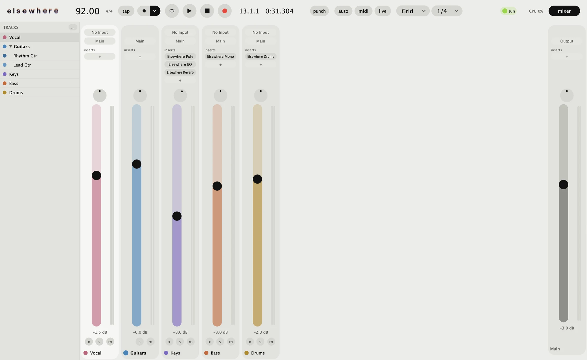

<h1 align="center">
  <picture>
    <source media="(prefers-color-scheme: dark)" srcset="docs/images/logo-on-dark.png">
    
  </picture>
</h1>

*Join us in the Extended Present, in Elsewhere.*

Elsewhere is a free, open-source DAW, built for playing and producing music with other people remotely: 
share a project through Dropbox or iCloud Drive and work on it together, or play live with each other in real time.

Built on [Tracktion Engine](https://github.com/Tracktion/tracktion_engine) (audio engine, plug-in hosting,
clip launching, rendering) and [JUCE](https://juce.com) (UI, CoreAudio, VST3/AU). It runs on macOS 10.15 Catalina
or newer as a universal binary (Intel + Apple Silicon), and on 64-bit Windows with an installer or a portable zip
(built by `.github/workflows/windows.yml`).

**Download** the latest version from [the website](https://somewhere-elsewhere.vercel.app/elsewhere) or from
[GitHub Releases](https://github.com/sigsound/elsewhere/releases/latest).

**Somewhere**, the companion sampler for iPhone and Android, sends what you record straight into Elsewhere
and links with it over Wi-Fi. It's [sold separately](https://somewhere-elsewhere.vercel.app); the protocol it speaks is documented in
`src/SomewhereLink.h`.

## A look around

<picture><source media="(prefers-color-scheme: dark)" srcset="docs/images/screenshots/arrangement-dark.webp"></picture>

*The arrangement, with a collaborator in the project (top right), their comments on the clips, and the piano roll below.*

<table>
<tr>
<td width="50%"><picture><source media="(prefers-color-scheme: dark)" srcset="docs/images/screenshots/devices-dark.webp"></picture><br><b>Devices.</b> Elsewhere's own instruments and effects, each with its full panel in the chain.</td>
<td width="50%"><picture><source media="(prefers-color-scheme: dark)" srcset="docs/images/screenshots/drums-dark.webp"></picture><br><b>Drum tracks.</b> Drag out sections, then pick a style and a feel; the pattern follows.</td>
</tr>
<tr>
<td width="50%"><picture><source media="(prefers-color-scheme: dark)" srcset="docs/images/screenshots/comments-dark.webp"></picture><br><b>Comments.</b> Notes on a stretch of a track, in song order, from everyone on the project.</td>
<td width="50%"><picture><source media="(prefers-color-scheme: dark)" srcset="docs/images/screenshots/session-dark.webp"></picture><br><b>Session view.</b> Launch clips and scenes, and record the performance into the arrangement.</td>
</tr>
<tr>
<td width="50%"><picture><source media="(prefers-color-scheme: dark)" srcset="docs/images/screenshots/mixer-dark.webp"></picture><br><b>Mixer.</b> Faders, pans, sends and inserts, with groups as one strip.</td>
<td width="50%"></td>
</tr>
</table>

Screenshots show "Night Drive", a demo song built by `scripts/make-screenshots.py`. They follow your GitHub theme, light or dark.

## Build

Requirements: Xcode (command-line tools), CMake 3.22+, Ninja.

```bash
git submodule update --init
# libdatachannel (live sessions) has dependencies of its own
git -C libs/libdatachannel submodule update --init --recursive
# Tracktion's JUCE submodule uses an SSH URL; fetch it over HTTPS instead
git -C libs/tracktion_engine config submodule.modules/juce.url https://github.com/juce-framework/JUCE.git
git -C libs/tracktion_engine submodule update --init modules/juce
cmake -S . -B build -G Ninja -DCMAKE_BUILD_TYPE=Release
cmake --build build --target Elsewhere
open build/Elsewhere_artefacts/Release/Elsewhere.app
```

To work in Xcode (debugger, Instruments), generate the project with its two schemes. Don't edit the Xcode project by hand; re-run this after adding files:

```bash
scripts/xcode.sh --open
```

Pick **Elsewhere (Debug)** to track down problems (it stops on failed sanity checks), or **Elsewhere (Release)** for full-speed playing and recording. Xcode builds target macOS 12+ because Xcode 27 won't go lower; release builds made from the command line support macOS 10.15 Catalina.

### App icon

The icon is four of Somewhere's Orbit marks sharing one dot, for collaboration: two opposed pairs, the second turned 75 degrees, in violet. Where the pairs cross, the colour deepens. On a Mac it comes from `resources/AppIcon.icon`, an Icon Composer file with a separate picture for light, dark and tinted (macOS 26 and later follow the system appearance; older versions show the light one). Windows and the About window use `resources/AppIcon.png`, which `scripts/make-icon.py` makes from `resources/Logo.png` (needs Pillow). Rebuild after changing either.

The wordmark in the transport bar and the About window is a picture of the letters in the same violet: `resources/WordmarkLight.png` for light themes and `WordmarkDark.png`, a lighter violet, for dark. Both are the same size, and `src/Wordmark.h` records where the letters sit in them, so keep that in step if you replace them. Rebuild afterwards.

`resources/Mark.svg` and `resources/Wordmark.svg` are the mark and wordmark as vectors. `docs/images/logo-on-light.png` and `logo-on-dark.png` are the mark and wordmark side by side, for the README.

### Signing

Builds from source are signed locally, which is all you need to run them. Official releases are signed and
notarized by Fuzz LLC: see [docs/RELEASING.md](docs/RELEASING.md). If you distribute your own build, give it
your own bundle ID (`-DELSEWHERE_BUNDLE_ID=`) and name (see [TRADEMARKS.md](TRADEMARKS.md)).

Dev flags:
- `--no-audio` skips opening the audio device.
- `--snapshot <dir>` renders the main views to PNGs and then quits.
- `--showcase <dir>` builds a demo song and saves each main view, dark and light, for the README (`scripts/make-screenshots.py` runs it).
- `--collab-test <A|B|C> <dir>` runs a scripted collaboration session (used by `scripts/tests/collab-sync.sh`).
- `--device-test <dir>` checks Elsewhere's built-in devices, drum patterns and modulators; `--plugin-test <dir>` checks installed test plug-ins (Surge XT, Valhalla Supermassive, Sitala).

## Features

- **Session view**: clip-launcher grid with scenes, launch quantisation, per-track mixer strips (arm/solo/mute, fader, pan, meters), and drag-and-drop of audio loops (warped to tempo) and MIDI files into slots.
- **Arrangement view**: timeline with bars/beats grid and snapping, clips you can move, trim, fade, split, duplicate, loop, reverse, normalize, and move between tracks, waveform display, a loop brace (drag either end's dot to resize it), follow-playhead, zoom (Cmd+scroll or pinch), and resizable tracks.
- **Normalize**: bring a clip to a set level. Right-click a clip (or several) → Normalize…, a track's menu → Normalize Track…, or the clip editor. Choose **Peak** (the loudest sample, in dBFS) or **Loudness** (BS.1770, in LUFS, which brings up quiet takes with a few loud spikes), a target, and, for several clips, whether they move individually, per track or all together. The dialog shows the gain change before you apply it. It sets the clip's gain rather than rewriting the audio, so it can be undone or adjusted in the clip's Gain knob.
- **Clip editor**: drag across an audio clip's waveform to select part of it (it starts with all of it selected), then right-click to normalize, reverse, delete (or press Delete), trim to it, split at it, or comment on it. Edits split the clip at the selection's edges and leave the rest alone.
- **Solo**: solos add up (solo a guitar, then its return, to hear both); Cmd-click a solo button to solo just that track.
- **Piano roll**: draw, move, resize and delete notes, transpose (arrow keys), quantise (Q), and audition notes.
- **Devices**: a device chain with Elsewhere's own devices, each with its full panel in the chain:
  - Instruments: **Mono** (Seventy, Acid and Sync Lead models), **Poly** (Prism, Quad, Velvet and Nova models, unison, chords, chorus; Nova is a two-channel flagship poly with velocity and aftertouch on every note), **Modular** (patch-cable modular synth, oversampled: VCOs, ladder filter, wavefolder, low-pass gate, ring mod, quantizer, slew, clock divider, random, sequencer, delay and more; live scopes on the jacks), **Haze** (nostalgic tape and VHS synth: wow and flutter, age, tracking glitches, chroma, hiss, slowed-down speed), **Organic** (recorded strings, winds, harp, mallets and textures reshaped by grain clouds, a resonant body and deep expression) and **Drums** (13 synthesised and recorded kits, drop in samples).
  - Sound packs: extra sounds download once into the user's library (`~/Library/Application Support/Elsewhere/Sounds`) instead of shipping in the app. Organic offers its pack (Organic Sounds, 123 MB, from VSCO 2 Community Edition, CC0) the first time it opens, or installs it from a zip; built-in sources play until then. `scripts/build-organic-pack.py` builds the pack.
  - MIDI effects: **Arpeggiator** and **Step Sequencer**, both tempo-synced.
  - Audio effects: **EQ** (8 bands, analyzer), **Compressor** (6 character models), **Reverb**, **Amp** (5 amp models, impulse-response cabinets or your own IR files) and **Master** (mastering chain with an assistant that sets loudness and tone).
  - Modulators: an **LFO** that can move any knob on its track, including plug-in parameters.
  - Plus the engine's basic effects, and **VST3 and AU plug-ins** with their own editor windows.
- **Drum tracks (Drum Designer)**: Create → Insert Drum Track (⇧⌘D). Drag across bars on the drum track to create sections (Intro, Verse, Chorus...), each with its own style (Rock, Pop, Funk, Hip-Hop, Trap, House, Drum & Bass, Half-time), Simple/Complex × Soft/Loud feel pad, per-part variation, fills and swing. The pattern updates as you change settings or resize the section; Convert to MIDI turns it into ordinary notes. Elsewhere Drums shows a drum-kit view where you can drop samples on each drum (or a whole folder). Sections can drive drum plug-ins too: Kit Notes picks General MIDI, pads from C1, or a custom layout.
- **Session → Arrangement recording**: press Record while launching clips and scenes, and the performance is written onto the timeline.
- **Import stems**: File → Import Audio/Stems (⌘I), or drop several files at once. Each file becomes its own track, lined up at bar 1, and is copied into the project. Stems play exactly as exported, with no warping.
- **Mixing**:
  - Return tracks (⌥⌘T) with post-fader sends on every track.
  - Group tracks (⌘G) as sub-mixes you can collapse. A group has one colour, chosen on the group, and its tracks show tones of it. A collapsed group shows everything it plays as one combined waveform, and is one strip in the Mixer.
  - Automation lanes (press **A**) for volume, pan, sends or any plug-in parameter. The **AUTO** button records knob and fader moves while playing.
- **Browser preview**: click an audio file to hear it.
- **Crash-safe plug-in scanning**: each plug-in is scanned in a separate helper process, so a bad plug-in can't crash Elsewhere.
- **Recording**: audio from any interface input (each input shows up as mono, plus stereo pairs), and MIDI from any keyboard. Selecting an instrument track routes the keyboard to it (auto-arm).
- **Transport**: tempo (drag or tap), time signature, metronome, loop, and a CPU meter.
- **Look (Orbit)**: the same design as Somewhere, in light and dark (following macOS, or set in Appearance): flat greys, ink for whatever is selected or on, red only for recording, and round keys, knobs and fader thumbs. Tracks are the only things with colours (twelve, in `src/Theme.h`): a clip is a wash of its track's colour with its waveform or notes in the full colour. The designs are on the "Elsewhere · Orbit" page of the Elsewhere Design System Penpot file.
- **Projects**: each project is a self-contained folder with relative paths. Imported audio is copied in, every save makes a timestamped backup, and you can export to WAV.
- **Sharing via Dropbox/iCloud**: a lock file warns you when your collaborator has the project open, and Elsewhere detects Dropbox "conflicted copies".

## Keyboard shortcuts

| Key | Action |
|---|---|
| Space | Play / stop |
| Tab | Switch Session / Arrangement |
| Shift+Tab | Switch Clip / Device panel |
| Cmd+T / Cmd+Shift+T | New audio / MIDI track |
| Cmd+Alt+T | New return track |
| Cmd+G | Group selected tracks |
| Cmd+I | Import audio / stems |
| A | Show / hide automation lane |
| Cmd+J | Go live (play together over the internet) |
| Cmd+M | MIDI Map mode (click a control, then move a knob on your controller) |
| Cmd+D, Cmd+E, Delete | Duplicate, split, delete |
| Cmd+L, Cmd+Shift+M | Loop, metronome |
| F9 | Record |
| Cmd+Z / Cmd+Shift+Z | Undo / redo |
| Cmd+, | Audio / MIDI settings |

## Roadmap

**Phase 1: parity basics ✅**
- Stems import, return tracks and sends, group tracks (in both views), automation lanes, browser preview, crash-safe plug-in scanning.
- Recording into Session clip slots, freezing tracks, and bouncing a track to a new audio track.
- Sample editor with warp markers.
- MIDI controller mapping (⌘M).
- Project templates (including a default template), and device presets.
- Recording a Session performance into the Arrangement (added later).

**Phase 2: working together on a shared project ✅**

Put the project folder in Dropbox (or iCloud Drive / Google Drive), turn on **File → Share Project…**, and share the folder with your collaborator. You can both have it open at the same time:
- **Syncing:** every change you make is appended to your own change log in `Collab/ops/`, and Elsewhere applies your collaborator's changes as they sync in, usually within a few seconds.
- **No conflicted copies:** each person only ever writes their own files.
- **Merging:** simultaneous edits are merged automatically. For the same setting, the latest change wins; simultaneously added items keep a consistent order on both machines.
- **Presence:** collaborators appear as coloured chips in the top bar, with a dot on the track they're working on.
- **Comments:** notes about a stretch of a track. Click **Add Comment** in the Comments tab and drag across a track to mark what it's about (or right-click a clip → Add Comment…, or comment on a selection in the clip editor). The Comments tab reads like a book: the contents list every note in song order, the open one shows as a page, and turning pages moves the playhead to it (while playing, it turns to the note under the playhead). Notes show as numbered marks along their tracks; click one to open it. Comments sync like everything else.
- **Version History:** File → Version History… reopens any earlier save as a separate copy.
- **Audio files:** imported audio is named by content, so two people importing different files with the same name never clash. Recordings are tagged with who made them. If audio arrives after the edit that uses it, Elsewhere picks it up as soon as it lands.
- **Tested:** `scripts/tests/collab-sync.sh <project folder>` runs two instances editing at once through a simulated, laggy cloud sync and checks that they end up identical.

**Phase 3: live jamming, the Extended Present ✅**

Open a shared project, press **LIVE** (⌘J) and press play. When your collaborator does the same, you connect automatically. You both play to the project's tempo and hear each other exactly one interval late (1–16 bars, 4 by default), so it's always in time musically, whatever the internet delay.

- **Low-latency mode** (Live tab → Mode): instead of intervals, you hear each other almost immediately. Audio streams in 5 ms Opus packets (about 128 kb/s) over an unordered, never-retransmitted channel, and Opus conceals lost packets. Each player's jitter buffer adapts: it starts at about 20 ms, grows if packets arrive unevenly, and shrinks back when the connection is steady. The Live tab shows each person's estimated delay. It feels natural under about 30 ms, which usually means the same region, wired internet, and a 128-sample audio buffer. The mode is stored in the project, so everyone switches together.
- **Direct connection, no Elsewhere server:** computers connect peer-to-peer over WebRTC, encrypted, through home routers via ICE. The connection handshake travels through the shared folder (`Collab/live/`). The only outside service is Google's free public STUN server, which tells each computer its public address.
- **What gets sent:** your master output, compressed to Ogg Vorbis (about 128 kb/s), one interval at a time. Collaborators' audio is mixed in on your master bus, with a volume and mute control per person in the **Live** tab.
- **Tested:** `scripts/tests/live-session.sh <project folder>` runs two instances that connect through a simulated cloud folder and exchange intervals.

- **Shared Session view:** launching a clip or scene (or stopping) does the same for everyone, each on their own next bar. Toggle it with "Share clip launches" in the Live tab.
- **Recording a live session:** press Record while live, and when you stop, each collaborator gets a "Name (live)" track with their part as you heard it, lined up on the timeline.
- **Clock-drift correction:** in low-latency mode, each player's audio is resampled by a few parts per million so the jitter buffer stays put, however different the two audio clocks are.

**Next**
- **Relay fallback:** a small relay for home networks that block direct connections (roughly 10–20% of networks). Needs a hosted server.

## Contributing

Contributions are welcome: see [CONTRIBUTING.md](CONTRIBUTING.md) for how to build, run the tests and send a
pull request. Everyone taking part follows the [Code of Conduct](CODE_OF_CONDUCT.md). To report a security
problem privately, see [SECURITY.md](SECURITY.md).

## License

Elsewhere is free software under the [GNU Affero General Public License v3.0 or later](LICENSE), copyright
Fuzz LLC. It uses JUCE under the AGPLv3 and Tracktion Engine under the GPLv3; the other third-party
components and their licences are listed in [resources/ThirdPartyNotices.txt](resources/ThirdPartyNotices.txt)
and explained in [docs/LICENSING.md](docs/LICENSING.md).

## Trademark

"Elsewhere", "Somewhere" and their logos are trademarks of Fuzz LLC. The licence covers the code, not the
names: forks are welcome, under a different name. See [TRADEMARKS.md](TRADEMARKS.md).
